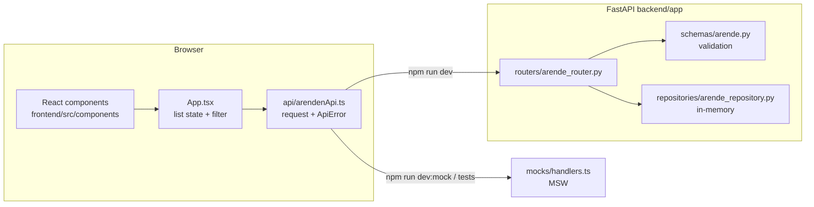
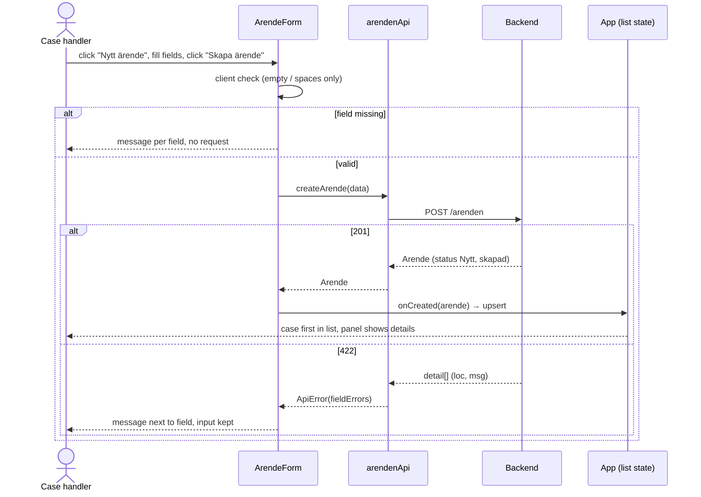
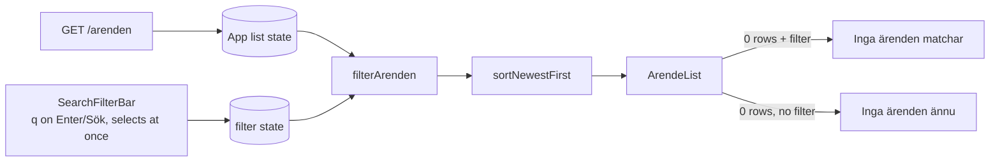
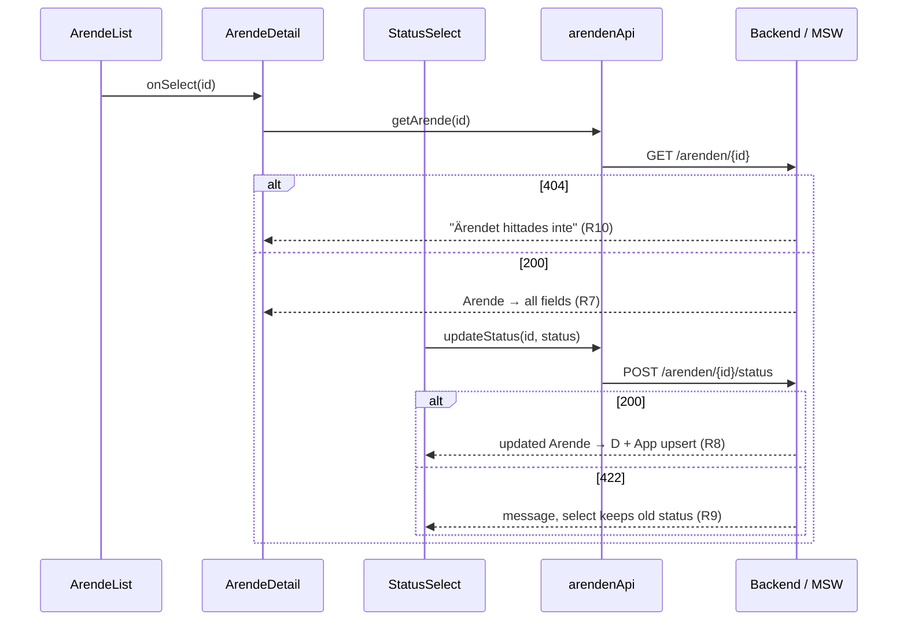
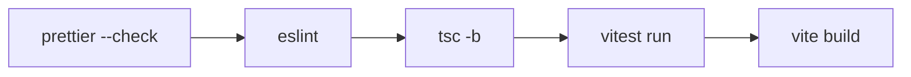

# Architecture flow

> Svensk version: [architecture-flow.sv.md](architecture-flow.sv.md)

How the frontend, backend, mocks and tests fit together. Requirement ids (R#, A#, Q#) refer to `../kundportal-sdd/specs/`.

## Overview



- `api/arendenApi.ts` is the only module that calls `fetch`.
- The same API module talks to the real backend or to MSW. Components do not know which one.
- Base URL: `VITE_API_URL`, default `http://127.0.0.1:8000`. Backend CORS allows `localhost:5173` and `127.0.0.1:5173`.

## Endpoints

| Method | Path | Used by | Status |
| --- | --- | --- | --- |
| GET | `/arenden` | `App.tsx` (list) | Backend + mock |
| GET | `/arenden/{id}` | `ArendeDetail.tsx` | Backend + mock |
| POST | `/arenden` | `ArendeForm.tsx` | Backend + mock |
| POST | `/arenden/{id}/status` | `StatusSelect.tsx` | **Mock only** (proposed) |
| PUT | `/arenden/{id}` | `ArendeForm.tsx` (edit) | **Mock only**, outside v1.0 scope |
| DELETE | `/arenden/{id}` | `ArendeDetail.tsx` | **Mock only**, outside v1.0 scope |

Postman collection for all of them: `docs/api/`.

## Frontend modules

```
frontend/src/
├── main.tsx              starts MSW worker in --mode mock, mounts App
├── App.tsx               list state, filter state, side panel (view / edit / create)
├── api/
│   ├── arendenApi.ts     listArenden, getArende, createArende, updateStatus, updateArende, deleteArende
│   └── apiError.ts       ApiError, toApiError (FastAPI detail → message + fieldErrors)
├── components/
│   ├── ArendeForm        R1–R4 (create) + edit
│   ├── ArendeList        R6, R11.5
│   ├── ArendeDetail      R7, R10, Redigera / Ta bort
│   ├── StatusSelect      R8, R9
│   ├── SearchFilterBar   R11.1–R11.4
│   └── StatusBadge
├── utils/
│   ├── filterArenden.ts  search + filter + sort (R11, R6)
│   └── formatDate.ts     UTC → sv-SE local time
├── constants/arende.ts   STATUSAR, provisional KATEGORIER/PRIORITETER (Q1/Q2)
├── types/arende.ts       Arende, ArendeCreate, ArendeStatus, ArendeFilter
├── mocks/                data.ts (C1–C3), handlers.ts, node.ts, browser.ts
└── test/setup.ts         MSW server + db.reset per test
```

## Page layout

```
┌───────────────────────────────────────────────┬──────────────────────┐
│ Alla ärenden                                  │      [+ Nytt ärende] │
├───────────────────────────────────────────────┼──────────────────────┤
│ Sök / filter                                  │ Side panel (aside)   │
│ ┌───────────────────────────────────────────┐ │ view:   details,     │
│ │ table, click row → panel view             │ │   Ändra status,      │
│ │ selected row highlighted                  │ │   Redigera, Ta bort  │
│ └───────────────────────────────────────────┘ │ edit:   ArendeForm   │
│                                               │ create: ArendeForm   │
└───────────────────────────────────────────────┴──────────────────────┘
```

- Default: list only, panel closed. Panel state in `App.tsx`: `closed | view(id) | edit(arende) | create`.
- From 900px width the panel is a sticky right column. On smaller screens it shows above the list.
- After create or edit: panel shows the saved case. After delete: panel closes, notice "Ärendet togs bort.".
- Delete asks for confirmation inside the panel ("Ja, ta bort" / "Avbryt").
- Edit/delete are behind `isEditDeleteEnabled()` (`src/constants/features.ts`): on in `npm run dev:mock`, off in `npm run dev` (buttons disabled, note "API saknas"). Force with `VITE_ENABLE_EDIT_DELETE=true|false`.
- Each row has edit (pencil) and delete (trash) icons. Edit opens the edit form; delete opens the panel with the confirmation shown.
- Edit form: "Spara ändringar" updates the case (`PUT`); "Spara som nytt ärende" creates a copy with status Nytt (`POST`) and leaves the original unchanged.

## Flow: create a case (R1–R4)



## Flow: list, search and filter (R6, R11)



- Search runs in the frontend on the loaded list. Reason: the backend has no search endpoint (Q9 open).
- Match: title + description (Q7 proposal), case-insensitive with `sv-SE` locale, trimmed. Plain text match, no regex, so `%`, `_`, `<script>` are safe.
- If Q9 closes as "backend", replace `filterArenden` with query params in `listArenden` and keep the same component API.

## Flow: details and status change (R7–R10)



## Error handling

| Source | Example | Shown to user |
| --- | --- | --- |
| 422 validation | `detail: [{loc: ["body","rubrik"], msg: "Value error, Får inte vara tomt…"}]` | Field message "Får inte vara tomt…" + "Kontrollera fälten och försök igen." |
| 404 | `detail: "Ärendet hittades inte"` | Same text |
| Network down | fetch throws | "Kunde inte nå servern. Försök igen." + retry button on list |
| Other / non-JSON | 500 | "Något gick fel. Försök igen." |

All mapping lives in `api/apiError.ts` (`toApiError`).

## Test levels

| Level | Tool | Files | Covers |
| --- | --- | --- | --- |
| Unit | Vitest | `utils/filterArenden.test.ts`, `api/arendenApi.test.ts` | R11 rules, error mapping |
| Component | Testing Library + MSW | `components/*.test.tsx` | A1–A4, A7–A10, edit/delete |
| App | Testing Library + MSW | `App.test.tsx` | A1, A6, A8, A14–A16, XSS text |
| API | Postman / Newman | `docs/api/*.json` | Real backend: A1–A3, A6, A7, A10 |
| Manual / browser | Playwright (optional) | — | Smoke against real backend |

## Build cycle



- Local: `cd frontend && npm run check`.
- CI: `.github/workflows/frontend.yml` runs `npm ci` + `npm run check` on pull requests that touch `frontend/`.

## Known gaps

- Editing and deleting are outside v1.0 scope (ADR-002, spec "Out of scope"). They work on mocks only. The team must update ADR-002 and the backend must add `PUT`/`DELETE /arenden/{id}` before they work for real.
- Status change and search filters are not in the backend yet. The UI works on mocks; against the real backend the status change shows "Not Found".
- Storage is in-memory, so R5 (survive restart) is not met. Backend task.
- Categories, priorities, list order and error texts use proposals (Q1, Q2, Q6, Q12).
