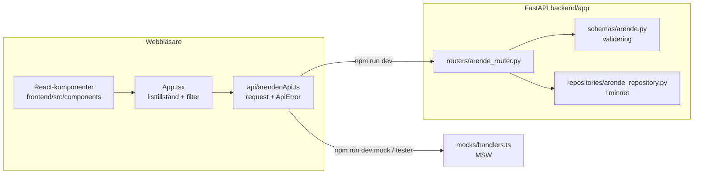
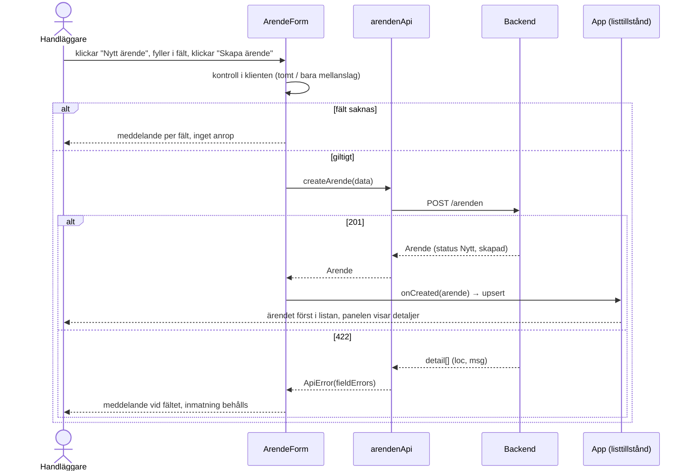
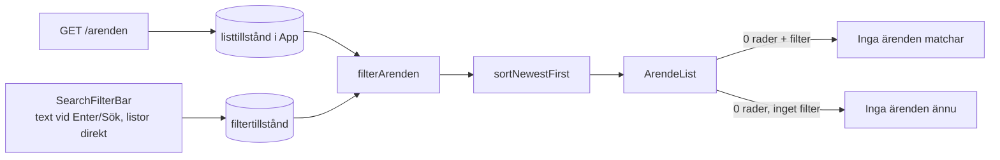
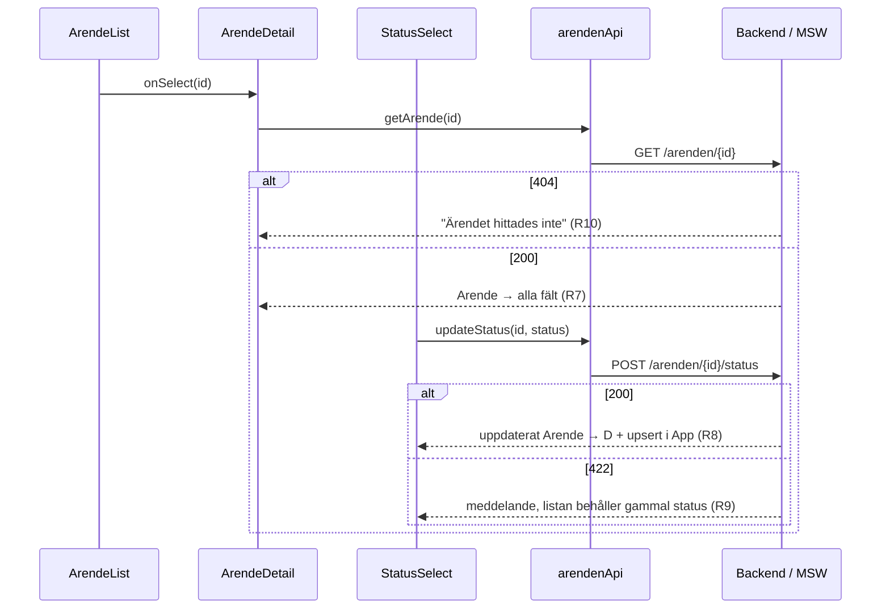
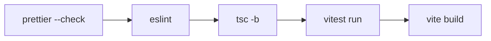

# Arkitekturflöde

> English version: [architecture-flow.md](architecture-flow.md)

Hur frontend, backend, mockar och tester hänger ihop. Krav-id (R#, A#, F#/Q#) syftar på `../kundportal-sdd/specs/`.

## Översikt



- `api/arendenApi.ts` är den enda modul som anropar `fetch`.
- Samma API-modul pratar med riktig backend eller med MSW. Komponenterna vet inte vilken.
- Bas-URL: `VITE_API_URL`, standard `http://127.0.0.1:8000`. Backendens CORS tillåter `localhost:5173` och `127.0.0.1:5173`.

## Endpoints

| Metod | Sökväg | Används av | Status |
| --- | --- | --- | --- |
| GET | `/arenden` | `App.tsx` (lista) | Backend + mock |
| GET | `/arenden/{id}` | `ArendeDetail.tsx` | Backend + mock |
| POST | `/arenden` | `ArendeForm.tsx` | Backend + mock |
| POST | `/arenden/{id}/status` | `StatusSelect.tsx` | **Bara mock** (förslag) |
| PUT | `/arenden/{id}` | `ArendeForm.tsx` (redigera) | **Bara mock**, utanför v1.0 |
| DELETE | `/arenden/{id}` | `ArendeDetail.tsx` | **Bara mock**, utanför v1.0 |

Postman-samling för alla: `docs/api/`.

## Frontendmoduler

```
frontend/src/
├── main.tsx              startar MSW-worker i --mode mock, monterar App
├── App.tsx               listtillstånd, filtertillstånd, sidopanel (visa / redigera / nytt)
├── api/
│   ├── arendenApi.ts     listArenden, getArende, createArende, updateStatus, updateArende, deleteArende
│   └── apiError.ts       ApiError, toApiError (FastAPI detail → meddelande + fieldErrors)
├── components/
│   ├── ArendeForm        R1–R4 (nytt) + redigera
│   ├── ArendeList        R6, R11.5
│   ├── ArendeDetail      R7, R10, Redigera / Ta bort
│   ├── StatusSelect      R8, R9
│   ├── SearchFilterBar   R11.1–R11.4
│   └── StatusBadge
├── utils/
│   ├── filterArenden.ts  sökning + filter + sortering (R11, R6)
│   └── formatDate.ts     UTC → lokal tid sv-SE
├── constants/arende.ts   STATUSAR, preliminära KATEGORIER/PRIORITETER (F1/F2)
├── types/arende.ts       Arende, ArendeCreate, ArendeStatus, ArendeFilter
├── mocks/                data.ts (C1–C3), handlers.ts, node.ts, browser.ts
└── test/setup.ts         MSW-server + db.reset per test
```

## Sidlayout

```
┌───────────────────────────────────────────────┬──────────────────────┐
│ Alla ärenden                                  │      [+ Nytt ärende] │
├───────────────────────────────────────────────┼──────────────────────┤
│ Sök / filter                                  │ Sidopanel (aside)    │
│ ┌───────────────────────────────────────────┐ │ visa:   detaljer,    │
│ │ tabell, klick på rad → panelen visar      │ │   Ändra status,      │
│ │ vald rad markeras                         │ │   Redigera, Ta bort  │
│ └───────────────────────────────────────────┘ │ redigera: ArendeForm │
│                                               │ nytt:   ArendeForm   │
└───────────────────────────────────────────────┴──────────────────────┘
```

- Standard: bara listan, panelen stängd. Paneltillstånd i `App.tsx`: `closed | view(id) | edit(arende) | create`.
- Från 900px bredd är panelen en fast kolumn till höger. På mindre skärmar visas den ovanför listan.
- Efter nytt eller redigering: panelen visar det sparade ärendet. Efter borttagning: panelen stängs, meddelande "Ärendet togs bort.".
- Borttagning kräver bekräftelse i panelen ("Ja, ta bort" / "Avbryt").
- Redigera/ta bort styrs av `isEditDeleteEnabled()` (`src/constants/features.ts`): på i `npm run dev:mock`, av i `npm run dev` (knappar avstängda, meddelande "API saknas"). Tvinga med `VITE_ENABLE_EDIT_DELETE=true|false`.
- Varje rad har ikoner för redigera (penna) och ta bort (papperskorg). Redigera öppnar formuläret; ta bort öppnar panelen med bekräftelsen.
- Redigera-formuläret: "Spara ändringar" uppdaterar ärendet (`PUT`); "Spara som nytt ärende" skapar en kopia med status Nytt (`POST`) och lämnar originalet orört.

## Flöde: registrera ärende (R1–R4)



## Flöde: lista, sök och filter (R6, R11)



- Sökningen körs i frontend på den laddade listan. Skäl: backend har ingen sök-endpoint, och den ignorerar okända query-parametrar (F9 öppen).
- Matchning: rubrik + beskrivning (förslag F7), skiftlägesokänslig med `sv-SE`, trimmad. Ren textmatchning utan regex, så `%`, `_`, `<script>` är ofarliga.
- Om F9 stängs som "backend": ersätt `filterArenden` med query-parametrar i `listArenden` och behåll komponenternas API.

## Flöde: detaljer och statusändring (R7–R10)



## Felhantering

| Källa | Exempel | Visas för användaren |
| --- | --- | --- |
| 422 validering | `detail: [{loc: ["body","rubrik"], msg: "Value error, Får inte vara tomt…"}]` | Fältmeddelande "Får inte vara tomt…" + "Kontrollera fälten och försök igen." |
| 404 | `detail: "Ärendet hittades inte"` | Samma text |
| Nätverket nere | fetch kastar fel | "Kunde inte nå servern. Försök igen." + knapp "Försök igen" på listan |
| Övrigt / inte JSON | 500 | "Något gick fel. Försök igen." |

All översättning av fel finns i `api/apiError.ts` (`toApiError`).

## Testnivåer

| Nivå | Verktyg | Filer | Täcker |
| --- | --- | --- | --- |
| Enhet | Vitest | `utils/filterArenden.test.ts`, `api/arendenApi.test.ts` | R11-regler, felöversättning |
| Komponent | Testing Library + MSW | `components/*.test.tsx` | A1–A4, A7–A10, redigera/ta bort |
| App | Testing Library + MSW | `App.test.tsx` | A1, A6, A8, A14–A16, XSS-text |
| API | Postman / Newman | `docs/api/*.json` | Riktig backend: A1–A3, A6, A7, A10 |
| Manuellt / webbläsare | Playwright (valfritt) | — | Röktest mot riktig backend |

## Byggcykel



- Lokalt: `cd frontend && npm run check`.
- CI: `.github/workflows/frontend.yml` kör `npm ci` + `npm run check` på pull requests som ändrar `frontend/`.

## Kända luckor

- Redigering och borttagning ligger utanför v1.0 (ADR-002, specens "Out of scope"). De fungerar bara mot mockar. Teamet måste uppdatera ADR-002 och backend måste lägga till `PUT`/`DELETE /arenden/{id}` innan de fungerar på riktigt.
- Statusändring och sökfilter finns inte i backend än. Gränssnittet fungerar mot mockar; mot riktig backend visar statusändringen "Not Found".
- Lagringen ligger i minnet, så R5 (finns kvar efter omstart) uppfylls inte. Uppgift för backend.
- Kategorier, prioriteter, listordning och feltexter använder förslag (F1, F2, F6, F12).
